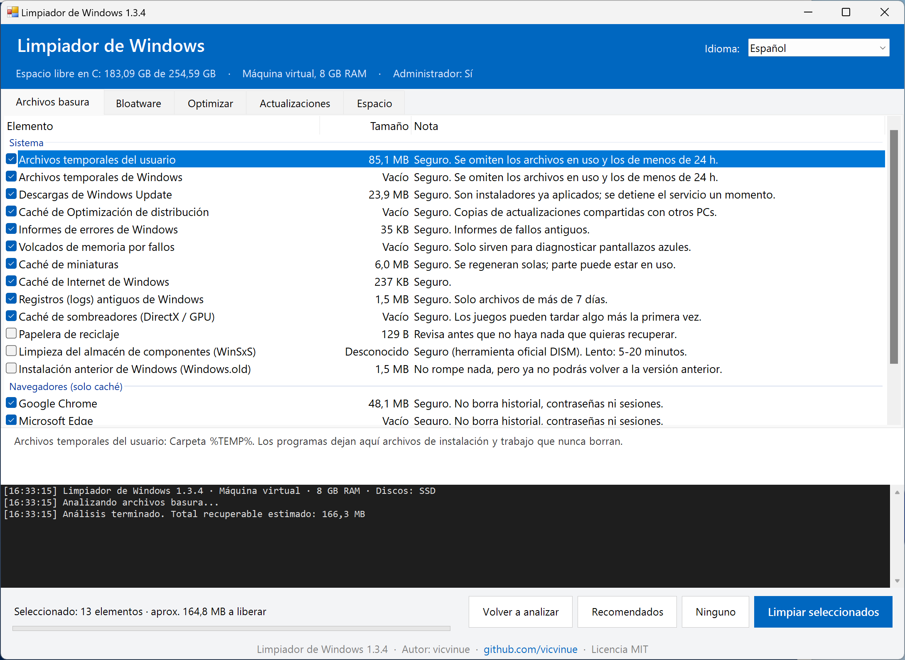
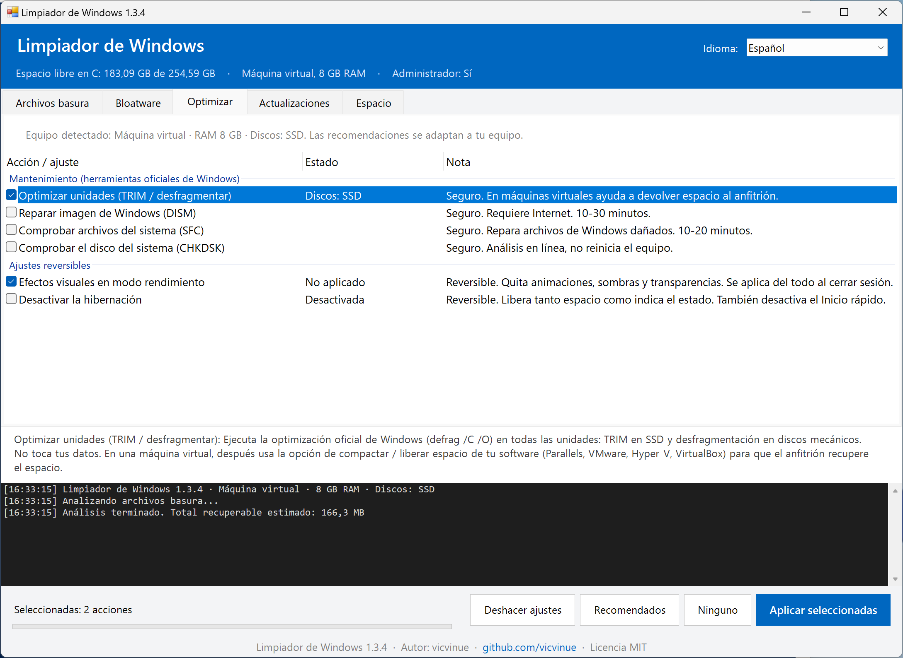
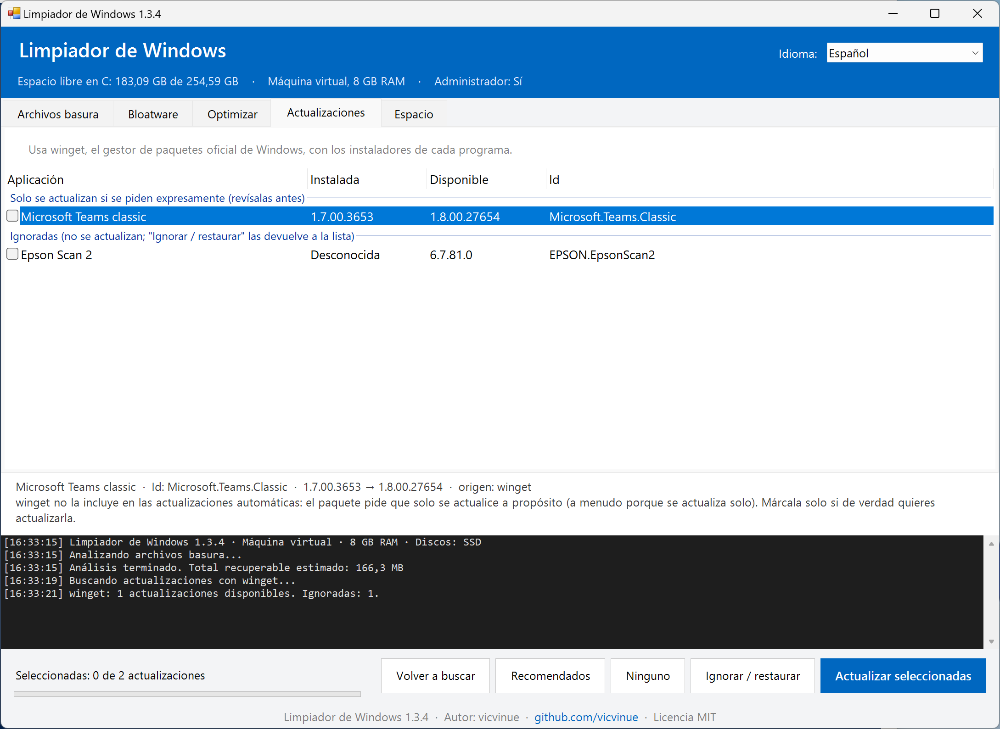

# Limpiador de Windows

Herramienta gráfica, gratuita y de código abierto para **liberar espacio y optimizar Windows 10/11 sin romper nada**.

Es un único script de PowerShell con interfaz gráfica: no hay que instalar nada, no tiene dependencias y puedes leer todo lo que hace antes de ejecutarlo.

**[⬇️ Descargar la última versión](https://github.com/vicvinue/limpiador-windows/releases/latest)**



> *English summary:* a single-file, dependency-free PowerShell GUI tool to safely clean junk files, remove preinstalled bloatware, run official Windows maintenance tools, update your apps with winget and find large files. Every change is conservative and reversible. **The interface is available in English and Spanish** and picks the language of your Windows automatically.

---

## Qué hace

### 🧹 Archivos basura
Analiza y muestra el tamaño de cada categoría antes de borrar nada:

| Sistema | Navegadores (solo caché) | Aplicaciones (solo caché) |
|---|---|---|
| Temporales del usuario y de Windows | Chrome, Edge, Brave, Vivaldi, Opera, Firefox | Discord, Teams clásico, VS Code, Steam |
| Descargas de Windows Update ya instaladas | *No toca historial, contraseñas, cookies ni sesiones* | Cachés de npm, pip, NuGet y Yarn (opcional) |
| Caché de Optimización de distribución | | |
| Informes de errores y volcados de memoria | | |
| Miniaturas, caché de Internet, sombreadores de GPU | | |
| Logs de Windows de más de 7 días | | |
| Papelera, WinSxS (DISM) y Windows.old *(opcionales)* | | |

Las categorías de programas que no tienes instalados no aparecen.

### 📦 Bloatware
Desinstala apps preinstaladas prescindibles: Noticias, Sugerencias, Candy Crush, accesos directos promocionales, Cortana, Películas y TV...
- Solo se muestran apps de una **lista cerrada y conservadora**. La Store, Edge, los componentes del sistema y los controladores nunca aparecen.
- Las apps se agrupan en *Recomendado quitar*, *Opcional* y *Juegos y Xbox*. Solo el primer grupo viene marcado por defecto.
- Crea un **punto de restauración** antes de desinstalar, y puede evitar que Windows reinstale esas apps.
- Todas se pueden reinstalar desde Microsoft Store.

### ⚙️ Optimizar
Detecta el tipo de equipo (sobremesa, portátil o máquina virtual), el tipo de disco (SSD o HDD) y la RAM, y adapta las recomendaciones:
- **Optimizar unidades**: TRIM en SSD o desfragmentación en HDD, con la herramienta oficial `defrag`.
- **Reparar Windows**: `DISM /RestoreHealth` y `sfc /scannow`.
- **Comprobar el disco**: `chkdsk /scan`, en línea y sin reiniciar.
- **Efectos visuales en modo rendimiento**: reversible.
- **Desactivar la hibernación**: libera varios GB; es reversible.

Todo ajuste guarda su valor original y se puede revertir con **Deshacer ajustes**.



### 🔄 Actualizaciones
Lista las aplicaciones instaladas que tienen una versión nueva, usando **winget**, el gestor de paquetes oficial de Windows. Se actualizan con el instalador de cada programa.
- Muestra la versión instalada, la disponible y el origen (`winget` o `msstore`). Puedes elegir qué actualizar.
- El progreso y la salida de cada instalador aparecen en la consola de la parte inferior.
- Las apps cuya versión instalada no se puede saber van en un grupo aparte y **no vienen marcadas**.
- Las que winget solo actualiza si se piden expresamente (por ejemplo, porque se actualizan solas) también van aparte y **sin marcar**.
- *Cancelar* detiene el proceso al terminar la app en curso: nunca interrumpe un instalador a medias.
- **Ignorar / restaurar**: oculta las apps que no quieres actualizar o que winget ofrece siempre aunque ya estén al día. Pasa con programas cuyo instalador no indica su versión, como Epson Scan 2. Usa `winget pin` y se deshace con el mismo botón; las ignoradas aparecen en su propio grupo.
- Si winget no está instalado, la pestaña lo indica. Se instala con *Instalador de aplicación* (App Installer) desde Microsoft Store.



### 📊 Espacio
Analizador de las carpetas y los archivos más grandes de tu perfil, de Descargas, de una unidad o de cualquier carpeta.
- Doble clic para entrar en una carpeta, y opción para abrir su ubicación en el Explorador.
- **Enviar a la papelera** en lugar de borrar, para poder recuperarlo. Las carpetas de Windows, las de los programas y las copias de instaladores (`Package Cache`) están protegidas.

### 🌐 Idioma / Language
La interfaz está en **español e inglés**:
- **Automático (por defecto):** español si Windows está en español (cualquier variante regional) e inglés en cualquier otro caso.
- **Manual:** desplegable *Idioma / Language* en la cabecera. La elección se guarda y la aplicación se reinicia en el nuevo idioma.
- **Línea de comandos:** `-Idioma es` o `-Idioma en` (alias `-Lang`).

---

## Principios de seguridad

- **Nunca** toca documentos, programas instalados, controladores ni componentes del sistema. La única excepción son las actualizaciones que tú elijas en la pestaña *Actualizaciones*.
- **No** limpia el registro (los "limpiadores de registro" no aceleran nada y pueden romper programas).
- **No** desactiva Windows Defender, Windows Update ni servicios del sistema.
- **No** sigue enlaces simbólicos ni uniones (junctions): nunca puede borrar fuera de la carpeta que limpia.
- Los archivos en uso se omiten; en las carpetas temporales tampoco se borra nada de las últimas 24 horas.
- Para lo delicado usa las herramientas oficiales de Windows: DISM, SFC, defrag, el Liberador de espacio y `Delete-DeliveryOptimizationCache`.
- Siempre muestra qué va a hacer y pide confirmación.

---

## Requisitos

- Windows 10 (1809 o posterior) o Windows 11.
- Windows PowerShell 5.1, que ya viene incluido en Windows.
- Permisos de administrador para las opciones del sistema. Sin ellos, la herramienta funciona con las opciones del usuario.

## Uso

1. Descarga **`LimpiadorWindows-vX.Y.Z.zip`** de la [última versión publicada](https://github.com/vicvinue/limpiador-windows/releases/latest) y descomprímelo.
2. Haz doble clic en **`Limpiador.bat`**.
3. Acepta el aviso de permisos de Windows (UAC).

> Descargar el código desde **Code → Download ZIP** también funciona, pero te dará la versión en desarrollo, que puede no ser estable.

> **Aviso de SmartScreen / archivo bloqueado:** los archivos descargados de Internet vienen marcados por Windows. Si no se abre, haz clic derecho en `Limpiador.ps1` → *Propiedades* → marca **Desbloquear**, o ejecuta en PowerShell:
> ```powershell
> Get-ChildItem -Path .\LimpiadorWindows -Recurse | Unblock-File
> ```

### Modo análisis (solo lectura)
Muestra en la consola lo que se podría limpiar, el bloatware detectado y el estado de las optimizaciones, **sin cambiar nada**:
```powershell
powershell -ExecutionPolicy Bypass -File .\Limpiador.ps1 -Analizar
```

## Registro y copia de seguridad

| Archivo | Contenido |
|---|---|
| `%LOCALAPPDATA%\LimpiadorWindows\limpieza.log` | Registro de todo lo que hace la herramienta |
| `%LOCALAPPDATA%\LimpiadorWindows\ajustes-originales.json` | Valores originales de los ajustes, usados por *Deshacer ajustes* |
| `%LOCALAPPDATA%\LimpiadorWindows\config.json` | Idioma elegido (si no es el automático) |

## Cómo deshacer cambios

| Acción | Cómo revertirla |
|---|---|
| Ajustes de la pestaña Optimizar | Botón **Deshacer ajustes** |
| Apps desinstaladas | Reinstalarlas desde Microsoft Store, o usar el punto de restauración creado antes de desinstalar |
| Archivos enviados a la papelera | Restaurarlos desde la Papelera de reciclaje |
| Archivos basura | No hace falta: son cachés y temporales que se regeneran solos |

## Contribuir

Las categorías de limpieza (`$Categories`), el catálogo de bloatware (`$BloatCatalog`) y las optimizaciones (`$Optimizations`) son listas declarativas al principio de `Limpiador.ps1`. Para proponer una nueva entrada, abre un *issue* o *pull request* explicando:
- qué es y por qué se puede quitar sin riesgo;
- en qué versiones de Windows aparece.

Criterio para aceptar cambios: si hay dudas razonables de que pueda romper algo, no se incluye, o se incluye **desmarcado** con una advertencia clara.

## Licencia

[MIT](LICENSE). Se distribuye "tal cual", sin garantías de ningún tipo. Úsalo bajo tu responsabilidad.
